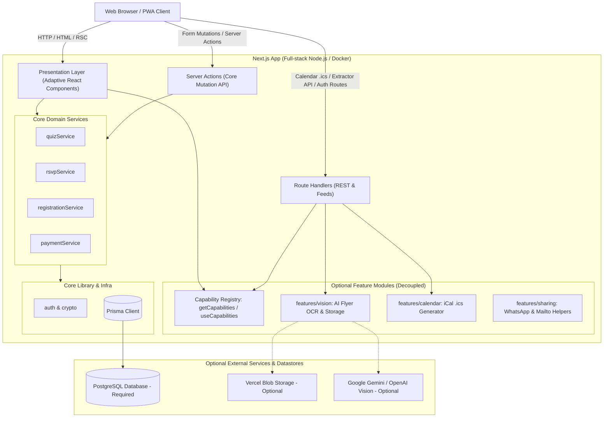

# Architecture Overview: be-quiz

Welcome to the **be-quiz** architecture documentation. This document outlines the high-level system architecture, design patterns, core subsystems, and directory boundaries of the application.

---

## 1. System Context & Overview

**be-quiz** is a collaborative quiz team coordination web application. It enables team members to organize upcoming trivia/quiz nights, track team RSVP rosters with automatic queueing, register and track team entry payments, extract quiz details directly from event flyers using AI Vision, and share event info via WhatsApp, email, or iCalendar.



---

## 2. Technology Stack

- **Framework:** [Next.js](https://nextjs.org/) (App Router, React 19 Server Components, Server Actions)
- **Language:** TypeScript
- **Database & ORM:** PostgreSQL managed with [Prisma ORM](https://www.prisma.io/)
- **Styling:** [Tailwind CSS](https://tailwindcss.com/) v4
- **Storage:** Dual-mode storage (Local filesystem in `public/uploads/` with fallback to `@vercel/blob`)
- **Testing:** [Vitest](https://vitest.dev/) for unit and integration testing
- **Containerization:** Docker (multi-stage build with musl OpenSSL support) & Docker Compose

---

## 3. Core Architectural Subsystems

### 3.1 Authentication & Authorization
- **Session & PIN Auth:** Passwordless/PIN-based authentication for team members, using cryptographically secure session tokens stored in the database (`Session` model) and encrypted HTTP cookies (`auth.ts`, `crypto.ts`).
- **Invite-based Onboarding:** Unique invitation links (`Invite` model) to onboard team members directly with pre-assigned roles (`USER` or `ADMIN`).
- **Role Enforcement:** Server Actions and Admin routes check the active session's role before executing privileged operations (e.g. member management, overrides, settings).

### 3.2 Quiz Lifecycle & Roster Concurrency
- **Event Management:** Quizzes track scheduling, Europe/Brussels time zones, durations, locations, entry fees, and flyer assets.
- **Roster & Queueing:** Each Quiz is linked 1-to-1 with a `Team` (`v1`). Members RSVP as `ATTENDING` or `DECLINED`.
- **First-Come, First-Served Queue:** When the team limit (`maxTeamSize`) is reached, excess RSVPs enter a reserve queue ordered by `queuedSince`.
- **Concurrency & Reordering:** Strict transactional updates via Prisma ensure that concurrent RSVPs, admin declines, and manual roster reordering maintain roster consistency without race conditions.

### 3.3 Capability Registry & Modular Features
- **Capability Registry (`src/features/capabilities/`):** Evaluates deployment settings based on environment variables (`ENABLE_AI_VISION`, `ENABLE_CALENDAR`, `ENABLE_SHARING`) and AI keys (`GEMINI_API_KEY`, `OPENAI_API_KEY`).
- **UI Adaptation:** The UI queries capabilities (via server helpers or client hook) to cleanly hide disabled features rather than showing disabled placeholders.
- **AI Flyer Extraction (`src/features/vision/`):** Optional module analyzing event flyers with multi-modal AI to extract event details.
- **Calendar & Sharing Helpers (`src/features/calendar/`, `src/features/sharing/`):** Optional modules for `.ics` calendar generation, WhatsApp lineup formatting, and email registration links.

---

## 4. Directory Structure

```text
├── prisma/
│   ├── schema.prisma         # Prisma schema definitions and relations
│   └── seed.ts               # Database seed script with demo members and quizzes
├── docs/
│   ├── architecture/         # High-level architecture and system diagrams
│   ├── adr/                  # Architectural Decision Records (ADR 0001, ADR 0002)
│   ├── api/                  # OpenAPI 3.1 specification (openapi.yaml) as single API source of truth
│   └── database/             # Database ER diagrams and field specifications
├── src/
│   ├── actions/              # Next.js Server Actions (mutations, validation, auth checks)
│   ├── app/                  # Next.js App Router (pages, layouts, API route handlers)
│   ├── components/           # React Server and Client Components (adaptive UI)
│   ├── features/             # Decoupled optional integration modules
│   │   ├── capabilities/     # Capability registry & client context provider
│   │   ├── vision/           # Vision service, flyer OCR prompt, storage adapters
│   │   ├── calendar/         # iCal feed generator and formatter
│   │   └── sharing/          # WhatsApp message generator, mailto drafts
│   ├── lib/                  # Shared core utilities (auth, DB client, crypto, formatters)
│   └── services/             # Core domain business logic (quiz, RSVP, payment, registration)
└── tests/                    # Vitest test suites (concurrency, business rules, services)
```

---

## 5. Architectural Invariants

1. **Service Layer Isolation:** Server Actions (`src/actions/`) act as controller adaptors. Complex domain rules, state transitions, and database queries live in `src/services/` to keep logic testable in isolation.
2. **Core Domain Independence:** Core domain services (`quizService`, `rsvpService`, `paymentService`, `registrationService`) have zero dependencies on auxiliary third-party APIs. The core app can operate with only PostgreSQL and Next.js.
3. **Deterministic Time Zone Handling:** All event dates are stored in UTC in the database, but formatted and computed with explicit awareness of the event's configured timezone (`Europe/Brussels` by default).
4. **Adaptive UI Contracts:** Disabled integrations are omitted from the user interface entirely, presenting a clean and purpose-built experience for each deployment mode.
5. **Database-enforced Integrity:** Foreign keys use strict constraints (`Cascade` for child sessions/RSVPs, `Restrict` for creators and registrars, `SetNull` for feedback authors).
6. **Single Source of Truth for Client State:** Client components that manage or reflect domain entities (e.g. RSVPs, rosters) must maintain a single unified collection or pure reducer as the sole source of truth. Child controls, status pills, and lineup partitions must be purely derived from this single state, never stored in duplicate or parallel state arrays that can drift (see [Client RSVP State: Single Source of Truth](./rsvp-state.md)).
7. **Node-based Deterministic Testing:** The test suite operates in Vitest under `environment: "node"`. Domain rules, transitions, and state reducers must be designed and verified as pure functions or backend service integration tests. Component tests verify markup via `renderToStaticMarkup` without relying on browser DOM emulation (`@testing-library/react`, `jsdom`).
