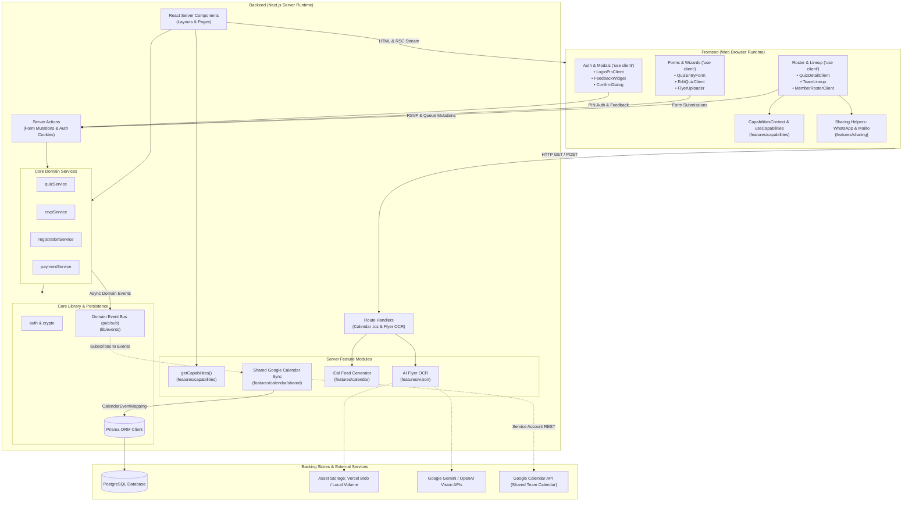

# Architecture Overview: be-quiz

Welcome to the **be-quiz** architecture documentation. This document outlines the high-level application architecture, subsystem boundaries, domain services, and runtime execution split between the browser and the server.

For details on compute models and deployment methods (Vercel vs. Docker), see [Deployment Overview](../deployment/overview.md).  
For details on backing services, databases, storage tiers, and networking, see [Infrastructure Overview](../infrastructure/overview.md).

---

## 1. System Context & Overview

**be-quiz** is a collaborative quiz team coordination web application. It enables team members to organize upcoming trivia/quiz nights, track team RSVP rosters with automatic queueing, register and track team entry payments, extract quiz details directly from event flyers using AI Vision, and share event info via WhatsApp, email, or iCalendar.

---

## 2. Runtime Execution Boundary: Browser vs. Server

The application cleanly partitions responsibilities between code executing in the **user's browser** and code executing on the **Next.js server runtime** (whether running on Vercel Serverless or in a standalone Docker container):

### 2.1 What Runs in the Browser (Client Side)

- **Interactive React Components (`"use client"`):**
  - **Lineup & RSVP Controls:** `QuizDetailClient`, `TeamLineup`, `MemberRosterClient` handle user taps, instant attendance status toggles, and drag-and-drop roster reordering.
  - **Creation & Edit Wizards:** `QuizEntryForm`, `EditQuizClient`, `FlyerUploader` handle drag-and-drop image uploads, clipboard pasting (`Ctrl+V`), and local preview rendering before submission.
  - **Authentication:** `LoginPinClient` provides the personal 4-digit PIN keypad and instant validation feedback.
  - **Interactive Overlays:** `FeedbackWidget` (with client-side screenshot capture via `html2canvas-pro`), `ConfirmDialog`, and dashboard tabs in `QuizzesDashboard`.
- **State Management & UI Adaptation:**
  - `CapabilitiesContext`: Consumes server-evaluated capabilities and exposes `useCapabilities()` so client components adaptively hide disabled feature buttons without visual layout shifts.
  - Pure state derivations: Attendee counts, waitlist numbers, and button states are derived on the fly from the authoritative single domain state.
- **Deep Links:** Launching native WhatsApp conversations and `mailto:` registration draft emails with pre-populated rosters.

### 2.2 What Runs on the Server Runtime

- **React Server Components (RSC):**
  - `layout.tsx` and `page.tsx` execute exclusively on the server, fetching data directly from PostgreSQL and streaming HTML/RSC payloads to the browser.
- **Server Actions (`src/actions/`):**
  - Acts as the mutation controller layer for form submissions and user actions (e.g., submitting RSVPs, overriding player statuses, updating quiz information).
  - Manages cryptographic session tokens and secure HTTP-only cookies (`auth.ts`, `crypto.ts`).
- **Route Handlers (`src/app/api/`):**
  - Dynamic calendar feed generation (`/api/quizzes/[id]/calendar.ics`) streaming standard `.ics` payloads.
  - AI flyer OCR extraction endpoint (`/api/quizzes/extract`).
- **Domain Services (`src/services/`):**
  - Contains all business rules, waitlist algorithms, roster limits, payment state transitions, and transactional queries (`rsvpService`, `quizService`, `paymentService`, `registrationService`).
  - Pure Prisma ORM interactions; completely isolated from presentation logic.
- **Protected External Integrations:**
  - Direct communication with Google Gemini or OpenAI Vision APIs using private server environment variables (`GEMINI_API_KEY`, `OPENAI_API_KEY`).
  - File storage writes via `@vercel/blob` tokens or local disk volume writes.

---

## 3. Technology Stack

- **Framework:** [Next.js](https://nextjs.org/) (App Router, React 19 Server Components, Server Actions)
- **Language:** TypeScript
- **Database & ORM:** PostgreSQL managed with [Prisma ORM](https://www.prisma.io/)
- **Styling:** [Tailwind CSS](https://tailwindcss.com/) v4
- **Storage:** Dual-mode storage (Local filesystem volume in `public/uploads/` with automatic fallback to `@vercel/blob`)
- **Testing:** [Vitest](https://vitest.dev/) for unit and integration testing
- **Code Quality & Formatting:** ESLint 9 (Flat Config) with `@next/eslint-plugin-next`, TypeScript-ESLint, and Prettier with `prettier-plugin-tailwindcss`
- **Security & Quality Verification:** `secretlint` (local pre-commit secret scanning), `audit-ci` (dependency CVE auditing), and `husky` + `lint-staged`
- **Containerization:** Multi-stage Docker build producing `.next/standalone` runner

---

## 4. Core Architectural Subsystems

### 4.1 Authentication & Authorization

- **Session & PIN Auth:** Passwordless/PIN-based authentication for team members, using cryptographically secure session tokens stored in the database (`Session` model) and encrypted HTTP cookies (`auth.ts`, `crypto.ts`).
- **Invite-based Onboarding:** Unique invitation links (`Invite` model) to onboard team members directly with pre-assigned roles (`USER` or `ADMIN`).
- **Role Enforcement:** Server Actions and Admin routes check the active session's role before executing privileged operations (e.g. member management, overrides, settings).

### 4.2 Quiz Lifecycle & Roster Concurrency

- **Event Management:** Quizzes track scheduling, Europe/Brussels time zones, durations, locations, entry fees, and flyer assets.
- **Roster & Queueing:** Each Quiz is linked 1-to-1 with a `Team`. Members RSVP as `ATTENDING` or `DECLINED`.
- **First-Come, First-Served Queue:** When the team limit (`maxTeamSize`) is reached, excess RSVPs enter a reserve queue ordered by `queuedSince`.
- **Concurrency & Reordering:** Strict transactional updates via Prisma ensure that concurrent RSVPs, admin declines, and manual roster reordering maintain roster consistency without race conditions.

### 4.3 Capability Registry & Modular Features

The **Capability Registry (`src/features/capabilities/`)** manages modular auxiliary integrations. Every optional integration defaults to `false` and requires explicit opt-in via environment variables.

| Capability                 | Property (`AppCapabilities`) | Environment Variable                                                      | Default | UI Impact when Disabled                                                                        | API Route Behavior                                                 |
| :------------------------- | :--------------------------- | :------------------------------------------------------------------------ | :------ | :--------------------------------------------------------------------------------------------- | :----------------------------------------------------------------- |
| **AI Flyer Vision**        | `vision`                     | `ENABLE_AI_VISION=true` (plus valid `GEMINI_API_KEY` or `OPENAI_API_KEY`) | `false` | Flyer dropzone, camera upload, and AI extraction prompt omitted; clean manual entry form shown | `POST /api/quizzes/extract` returns `501 Not Implemented`          |
| **iCal / Calendar Export** | `icalExport`                 | `ENABLE_ICAL_EXPORT=true`                                                 | `false` | `.ics` download link and "Add to Google Calendar" button hidden in `ActionToolbar`             | `GET /api/quizzes/[id]/calendar.ics` returns `501 Not Implemented` |
| **Shared Google Calendar** | `sharedGoogleCalendar`       | `ENABLE_SHARED_GOOGLE_CALENDAR=true` (with valid Google credentials)      | `false` | No direct button needed; background sync subscriber is not attached                            | N/A (background push)                                              |
| **WhatsApp Lineup Share**  | `whatsappShare`              | `ENABLE_WHATSAPP_SHARE=true`                                              | `false` | "Deel via WhatsApp" action button hidden in `ActionToolbar`                                    | N/A (client-side deep link)                                        |
| **Email Registration**     | `emailRegistration`          | `ENABLE_EMAIL_REGISTRATION=true`                                          | `false` | "Mail Inschrijving" action button hidden in `ActionToolbar`                                    | N/A (client-side mailto link)                                      |

- **Server Resolution:** Evaluated via `getCapabilities(env?: NodeJS.ProcessEnv)`.
- **Client Resolution:** Hydrated via `useCapabilities()` hook / context provider.
- **Adaptive UI Invariant:** When auxiliary buttons are disabled, the UI layout gracefully contracts to display only the core Payment and Registration controls without empty gaps or placeholder cards.
- **AI Flyer Extraction (`src/features/vision/`):** Optional module analyzing event flyers with multi-modal AI to extract event details.
- **Calendar & Sharing Helpers (`src/features/calendar/`, `src/features/sharing/`):** Optional modules for `.ics` calendar generation, WhatsApp lineup formatting, and email registration links.

### 4.4 Domain Event Bus & Asynchronous Decoupled Subscribers (`src/lib/events/`)

To preserve Core Domain Independence (Invariant 2), core domain services never invoke third-party integration APIs directly:

- **Event Bus:** A lightweight, strongly-typed in-process pub/sub event bus emits fine-grained domain events (`team.registered`, `team.registration_cancelled`, `quiz.details_updated`, `team.roster_changed`, `team.payment_changed`, `quiz.cancelled`).
- **Asynchronous Subscribers:** Feature modules (such as `src/features/calendar/shared/`) subscribe to domain events. When a subscriber is triggered, it runs asynchronously and isolates errors: failures in external APIs log structured error diagnostics without ever failing the user's action or rolling back database state.
- **Serverless Background Coordination:** On serverless platforms (such as Vercel), asynchronous promises returned by event listeners are scheduled via Next.js `after()` (`next/server`) dynamically when executed within a server action or route request context. This prevents the serverless runtime from freezing or terminating early before background Google Calendar API requests and database mappings settle, while gracefully falling back to standard unblocked promises in tests and CLI scripts.
- **Chunk-Safe Singleton Lifecycle:** The in-process event bus is anchored to `globalThis.__domainEvents__` to ensure that listeners registered during server startup (`src/instrumentation.ts`) remain authoritative when Server Actions or API routes emit events from separate webpack closures.
- **Test Isolation:** The event bus provides a `clear()` method enabling pure, deterministic unit and integration testing without leftover cross-test listeners.

---

## 5. Architectural Invariants

1. **Service Layer Isolation:** Server Actions (`src/actions/`) act as controller adaptors. Complex domain rules, state transitions, and database queries live in `src/services/` to keep logic testable in isolation.
2. **Core Domain Independence:** Core domain services (`quizService`, `rsvpService`, `paymentService`, `registrationService`) have zero dependencies on auxiliary third-party APIs. The core app can operate with only PostgreSQL and Next.js.
3. **Deterministic Time Zone Handling:** All event dates are stored in UTC in the database, but formatted and computed with explicit awareness of the event's configured timezone (`Europe/Brussels` by default).
4. **Adaptive UI Contracts:** Disabled integrations are omitted from the user interface entirely, presenting a clean and purpose-built experience for each deployment mode.
5. **Database-enforced Integrity:** Foreign keys use strict constraints (`Cascade` for child sessions/RSVPs, `Restrict` for creators and registrars, `SetNull` for feedback authors).
6. **Single Source of Truth for Client State:** Client components that manage or reflect domain entities (e.g. RSVPs, rosters) must maintain a single unified collection or pure reducer as the sole source of truth. Child controls, status pills, and lineup partitions must be purely derived from this single state, never stored in duplicate or parallel state arrays that can drift (see [Client RSVP State: Single Source of Truth](./rsvp-state.md)).
7. **Node-based Deterministic Testing:** The test suite operates in Vitest under `environment: "node"`. Domain rules, transitions, and state reducers must be designed and verified as pure functions or backend service integration tests. Component tests verify markup via `renderToStaticMarkup` without relying on browser DOM emulation (`@testing-library/react`, `jsdom`).
8. **Zero Secret Leakage:** Database connection strings, encryption secrets, and third-party AI keys never pass to the client bundle; all sensitive interactions are guarded by server boundaries.
9. **Cross-Chunk In-Process Singleton Persistence:** In Next.js server runtimes where Webpack/Turbopack code-splits Server Components, Server Actions, Route Handlers, and Instrumentation into isolated module closures, any stateful in-process infrastructure intended to be shared across execution boundaries (such as database connection pools or domain event brokers) must be anchored to `globalThis`. Naive file-level `new Service()` singletons are strictly prohibited for shared runtime infrastructure because chunk isolation causes silent state divergence in serverless deployments.

---

## 6. Developer Tooling & Security Standards

To maintain high architectural standards without relying on remote CI, code quality and security verification are enforced locally via fast, platform-agnostic tools:

- **Formatting (Single Source of Truth):** Prettier (`.prettierrc.json`) formats TypeScript, TSX, CSS, JSON, and Markdown. The `prettier-plugin-tailwindcss` plugin automatically organizes utility classes into deterministic order across all UI components.
- **Linting & Code Quality:** ESLint (`eslint.config.mjs`) uses ESLint 9 flat configuration extending `@next/eslint-plugin-next/core-web-vitals` and TypeScript rules. `eslint-config-prettier` turns off all conflicting stylistic rules so formatting is solely owned by Prettier.
- **Local Secret Scanning:** `secretlint` (`.secretlintrc.json`) scans for API keys, database connection strings, JWT tokens, and private keys. It is 100% pure Node.js, running natively across Linux, macOS, and Windows with zero binary dependencies.
- **Dependency CVE Auditing:** `audit-ci` (`audit-ci.json`) verifies upstream npm packages against moderate, high, and critical advisories. Transitive vendor advisories are actively patched via `package.json#overrides` to keep the allowlist strictly empty (`[]`). Premature or unmonitored allowlisting is prohibited.
- **Sub-Second Pre-Commit Verification:** Git hooks via `husky` and `lint-staged` execute Secretlint, Prettier, and ESLint strictly on staged files prior to commit creation, ensuring zero developer lag and preventing secret leaks from entering Git history.
- **Verification Commands:**
  - `npm run lint`: Runs ESLint across all codebase files.
  - `npm run lint:fix`: Automatically fixes autofixable lint issues.
  - `npm run format:check`: Confirms all files conform to Prettier code style.
  - `npm run format:write`: Formats all repository files and sorts Tailwind classes.
  - `npm run scan:secrets`: Runs Secretlint across all tracked files.
  - `npm run audit:check`: Verifies that no unallowlisted moderate, high, or critical CVEs exist.
  - `npm run check:all`: Runs typecheck, unit tests, linter, formatting checks, security audit, and secret scanning in a unified pipeline.
