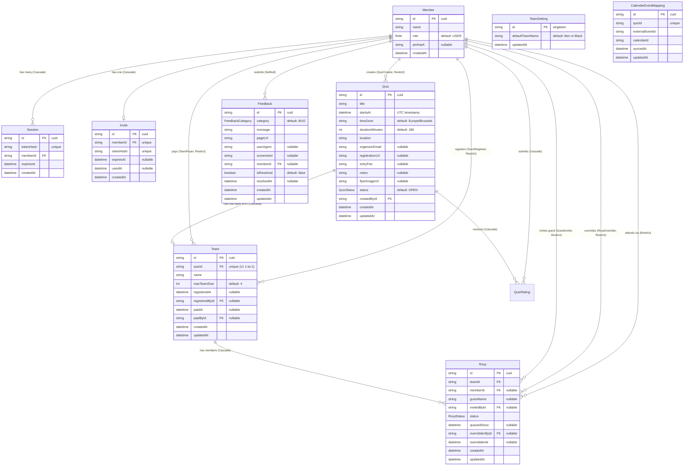

# Database Schema Documentation: be-quiz

This document details the complete PostgreSQL database schema managed via Prisma (`prisma/schema.prisma`).

---

## 1. Entity Relationship Diagram (Mermaid)

---

## 2. Enums

### `Role`

- `USER`
- `ADMIN`

### `QuizStatus`

- `OPEN`
- `CANCELLED`
- `ARCHIVED`

### `RsvpStatus`

- `ATTENDING`
- `DECLINED`

### `FeedbackCategory`

- `BUG`
- `IDEA`
- `QUESTION`

---

## 3. Detailed Model Specifications

### 3.1 `Member`

Represents users/players and administrators.

- **Attributes:**
  - `id` (`String` / `cuid`, PK)
  - `name` (`String`)
  - `role` (`Role`, default: `USER`)
  - `pinHash` (`String?`): Optional hashed PIN for authentication.
  - `createdAt` (`DateTime`, default: `now()`)
- **Relations:**
  - `sessions`: 1-to-many with `Session` (Cascade delete).
  - `invite`: 1-to-1 with `Invite` (Cascade delete).
  - `quizzesCreated`: 1-to-many with `Quiz` (`@relation("QuizCreator")`, Restrict delete).
  - `teamsRegistered`: 1-to-many with `Team` (`@relation("TeamRegistrar")`, Restrict delete).
  - `teamsPaid`: 1-to-many with `Team` (`@relation("TeamPayer")`, Restrict delete).
  - `rsvps`: 1-to-many with `Rsvp` (Restrict delete).
  - `overridesGiven`: 1-to-many with `Rsvp` (`@relation("RsvpOverrider")`, Restrict delete).
  - `guestRsvps`: 1-to-many with `Rsvp` (`@relation("GuestInviter")`, Restrict delete).
  - `feedbacks`: 1-to-many with `Feedback` (SetNull delete).
  - `quizRatings`: 1-to-many with `QuizRating` (Cascade delete).

---

### 3.2 `Quiz`

Represents an organized quiz event.

- **Attributes:**
  - `id` (`String` / `cuid`, PK)
  - `title` (`String`)
  - `startsAt` (`DateTime`): UTC timestamp of quiz start.
  - `timeZone` (`String`, default: `"Europe/Brussels"`)
  - `durationMinutes` (`Int`, default: `180`)
  - `location` (`String`)
  - `organizerEmail` (`String?`)
  - `registrationUrl` (`String?`)
  - `entryFee` (`String?`): Informational display fee string (e.g. `"€20 / ploeg"`).
  - `notes` (`String?`)
  - `flyerImageUrl` (`String?`): Optional URL to uploaded flyer image; populated when the Vision/Storage integration is active. Safe for core-only deployments where it remains `null`.
  - `status` (`QuizStatus`, default: `OPEN`)
  - `createdById` (`String`, FK $\to$ `Member.id`)
  - `createdAt` / `updatedAt` (`DateTime`)
- **Indexes:**
  - `@@index([startsAt, status])`
- **Relations:**
  - `createdBy`: `Member` (`@relation("QuizCreator")`, Restrict delete).
  - `team`: 1-to-1 with `Team` in v1 (`quizId` unique, Cascade delete).

---

### 3.3 `Team`

Represents our quiz team participation for a particular quiz.

- **Attributes:**
  - `id` (`String` / `cuid`, PK)
  - `quizId` (`String`, unique FK $\to$ `Quiz.id`): Enforces 1 team per quiz in v1.
  - `name` (`String`)
  - `maxTeamSize` (`Int`, default: `4`)
  - `registeredAt` (`DateTime?`)
  - `registeredById` (`String?`, FK $\to$ `Member.id`, Restrict delete)
  - `paidAt` (`DateTime?`)
  - `paidById` (`String?`, FK $\to$ `Member.id`, Restrict delete)
  - `createdAt` / `updatedAt` (`DateTime`)
- **Indexes:**
  - `@@index([quizId])`
- **Relations:**
  - `quiz`: `Quiz` (Cascade delete).
  - `registeredBy`: `Member?` (`@relation("TeamRegistrar")`).
  - `paidBy`: `Member?` (`@relation("TeamPayer")`).
  - `rsvps`: 1-to-many with `Rsvp` (Cascade delete).

---

### 3.4 `Rsvp`

Tracks a member's attendance intention, queue order, and administrative overrides.

- **Attributes:**
  - `id` (`String` / `cuid`, PK)
  - `teamId` (`String`, FK $\to$ `Team.id`)
  - `memberId` (`String?`, FK $\to$ `Member.id`): Nullable for external guest players.
  - `guestName` (`String?`): Name of the external guest player.
  - `invitedById` (`String?`, FK $\to$ `Member.id`): Member who invited the guest player.
  - `status` (`RsvpStatus`): `ATTENDING` or `DECLINED`.
  - `queuedSince` (`DateTime?`): Timestamp tracking place in the roster queue.
  - `overriddenById` (`String?`, FK $\to$ `Member.id`): Member who issued an administrative decline.
  - `overriddenAt` (`DateTime?`)
  - `createdAt` / `updatedAt` (`DateTime`)
- **Constraints & Indexes:**
  - `@@unique([teamId, memberId])`
  - `@@index([teamId, status, queuedSince])`
  - `@@index([invitedById])`
- **Relations:**
  - `team`: `Team` (Cascade delete).
  - `member`: `Member?` (Restrict delete).
  - `invitedBy`: `Member?` (`@relation("GuestInviter")`, Restrict delete).
  - `overriddenBy`: `Member?` (`@relation("RsvpOverrider")`).

---

### 3.5 `Invite` & `Session`

Authentication and onboarding credentials.

- **`Invite`**:
  - `id`, `memberId` (unique FK $\to$ `Member.id`), `tokenHash` (unique), `expiresAt?`, `usedAt?`, `createdAt`.
  - Delete rule: Cascade on `Member` delete.
- **`Session`**:
  - `id`, `tokenHash` (unique), `memberId` (FK $\to$ `Member.id`), `expiresAt`, `createdAt`.
  - Delete rule: Cascade on `Member` delete.

---

### 3.6 `TeamSetting`

A singleton table storing system-wide team defaults.

- `id` (`String`, PK, default: `"singleton"`)
- `defaultTeamName` (`String`, default: `"Onze Quizploeg"`)
- `updatedAt` (`DateTime`)

---

### 3.7 `Feedback`

Captures in-app user feedback, bug reports, and screenshots.

- **Attributes:**
  - `id` (`String` / `cuid`, PK)
  - `category` (`FeedbackCategory`, default: `BUG`)
  - `message` (`String`)
  - `pageUrl` (`String`)
  - `userAgent` (`String?`)
  - `screenshot` (`String?`)
  - `memberId` (`String?`, FK $\to$ `Member.id`, SetNull delete)
  - `isResolved` (`Boolean`, default: `false`)
  - `resolvedAt` (`DateTime?`)
  - `createdAt` / `updatedAt` (`DateTime`)
- **Indexes:**
  - `@@index([createdAt])`
  - `@@index([isResolved])`

---

### 3.8 `CalendarEventMapping` (Integration Model)

Tracks synchronization state between internal quizzes and external Google Calendar events for the shared team calendar.

- **Decoupling Invariant:** Stored separately from `Quiz` and `Team` so that core domain tables remain 100% agnostic of external Google Calendar IDs and metadata.
- **Attributes:**
  - `id` (`String` / `cuid`, PK)
  - `quizId` (`String`, unique index): Identifier of the synchronized quiz.
  - `externalEventId` (`String`): Identifier assigned by Google Calendar API.
  - `calendarId` (`String`): Google Calendar ID where the event was created.
  - `syncedAt` (`DateTime`, default: `now()`)
  - `updatedAt` (`DateTime`): Last timestamp of successful synchronization.
- **Indexes:**
  - `@@unique([quizId])`
  - `@@index([quizId])`

---

### 3.9 `QuizRating` (Evaluation Model)

Stores post-quiz evaluations (1 to 5 stars) submitted by confirmed active team players.

- **Attributes:**
  - `id` (`String` / `cuid`, PK)
  - `quizId` (`String`, FK $\to$ `Quiz.id`, Cascade delete)
  - `memberId` (`String`, FK $\to$ `Member.id`, Cascade delete)
  - `score` (`Int`): Constrained to 1, 2, 3, 4, or 5 in the domain service.
  - `createdAt` / `updatedAt` (`DateTime`)
- **Constraints & Indexes:**
  - `@@unique([quizId, memberId])`
  - `@@index([quizId])`
  - `@@index([memberId])`
- **Relations:**
  - `quiz`: `Quiz` (Cascade delete).
  - `member`: `Member` (Cascade delete).
