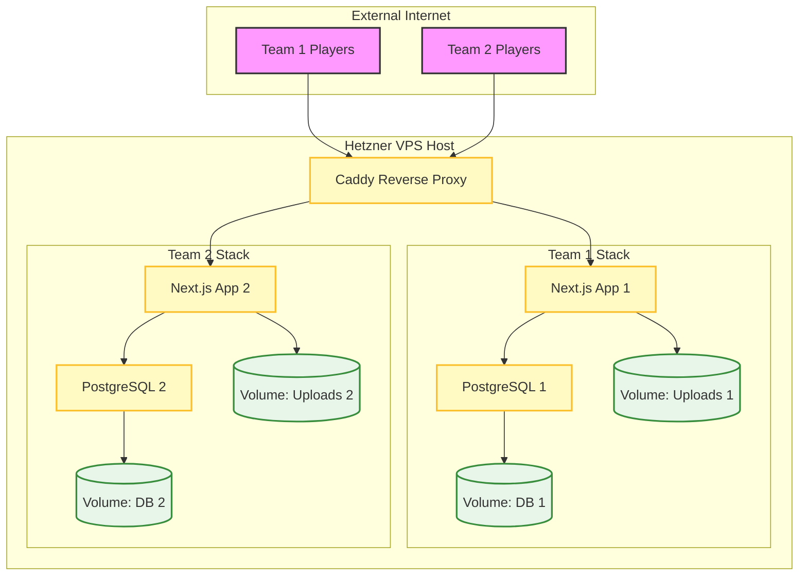
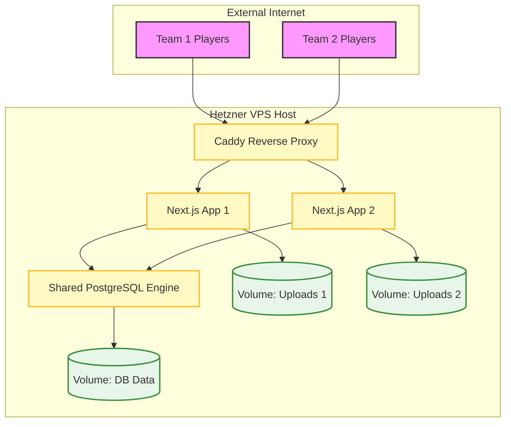
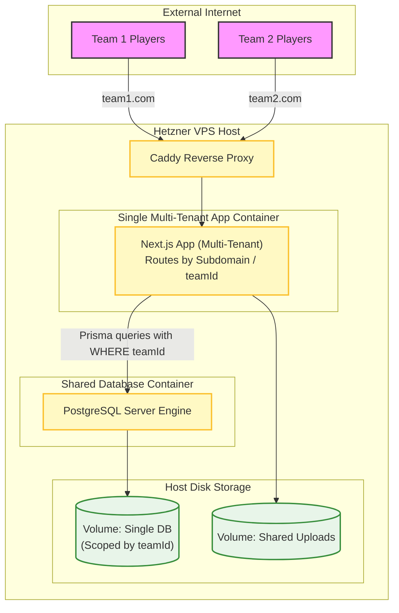

# VPS Deployment Architectures for Multi-Team be-quiz

**Date:** 2026-11-07  
**Scope:** VPS (Hetzner CX23 @ ~€6.49/mo) with Docker Compose and Zero Cold-Start Lag.

---

## Architecture A: Multi-Database Stack (5 Containers)

In this model, each team has its own independent PostgreSQL container and database.

- **Containers (5):** Caddy proxy + 2x Next.js app containers + 2x PostgreSQL containers.
- **Pros:** 100% physical data separation; complete database independence.
- **Cons:** Slightly higher memory footprint.

---

## Architecture B: Single Database with Schema-per-Tenant (4 Containers)

In this model, both teams share a single PostgreSQL container, but their data is strictly isolated into separate database schemas.

- **Containers (4):** Caddy proxy + 2x Next.js app containers + 1x Shared PostgreSQL container.
- **Pros:** Lower resource usage; single database instance to back up.
- **Cons:** Shared database engine process.

---

---

## Architecture C: Code-Level Multi-Tenancy (3 Containers)

In this model, a single Next.js app container handles all teams, inspecting subdomains at the middleware level and scoping all database queries by `teamId` inside a single shared database.

- **Containers (3):** Caddy proxy + 1x Multi-Tenant Next.js app container + 1x Shared PostgreSQL container.
- **Pros:** Minimal container footprint; single codebase deployment.
- **Cons:** Requires a massive code refactor across all Prisma queries, server actions, and routing middleware; high security risk of cross-tenant data leaks if a query filter is missed.

---

## Cost Calculation & Resource Comparison

All three architectures run on the same Hetzner Cloud **CX23** instance (**2 vCPU, 4GB RAM, 40GB NVMe SSD**) located in Germany/Finland, priced at **€5.99/mo + €0.50 IPv4 = €6.49/mo (excl. VAT)**.

| Metric / Resource           | Architecture A (Multi-DB)           | Architecture B (Schema-per-Tenant)  | Architecture C (Code Multi-Tenant)                |
| :-------------------------- | :---------------------------------- | :---------------------------------- | :------------------------------------------------ |
| **Total Containers**        | **5** (Caddy + 2 Apps + 2 Postgres) | **4** (Caddy + 2 Apps + 1 Postgres) | **3** (Caddy + 1 App + 1 Postgres)                |
| **RAM Footprint (Approx.)** | ~450 MB / 4 GB                      | ~400 MB / 4 GB                      | ~300 MB / 4 GB                                    |
| **Disk Space (Approx.)**    | ~1.2 GB / 40 GB                     | ~1.0 GB / 40 GB                     | ~0.8 GB / 40 GB                                   |
| **Code Refactor Required**  | **None**                            | **None**                            | **Massive** (Tenant filtering across all queries) |
| **Monthly Hosting Cost**    | **€6.49 / mo**                      | **€6.49 / mo**                      | **€6.49 / mo**                                    |
