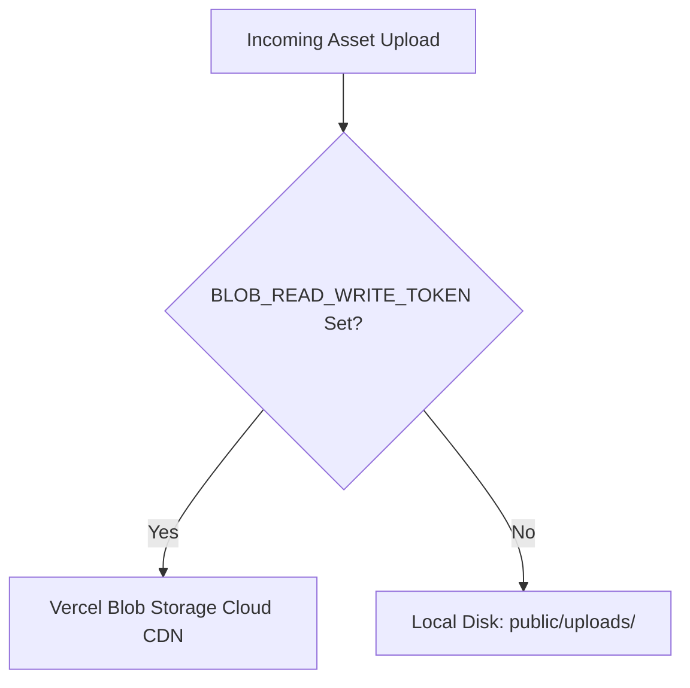

# Infrastructure & Backing Services: be-quiz

This document outlines the backing services, physical/cloud topologies, data persistence layers, asset storage models, and networking ingress patterns for **be-quiz**.

For the software component boundaries, consult [Architecture Overview](../architecture/overview.md). For compute models and build procedures, consult [Deployment Overview](../deployment/overview.md).

---

## 1. Database Layer (PostgreSQL)

**be-quiz** requires a single PostgreSQL database instance managed via **Prisma ORM**.

### 1.1 Connection Pooling by Hosting Environment

- **Serverless Hosting (Vercel / AWS Lambda):**
  - Ephemeral serverless functions can quickly open hundreds of concurrent connections and exhaust database connection limits.
  - **Requirement:** Must use a connection pooling proxy such as **Prisma Postgres**, **Neon Serverless Pooler**, or **PgBouncer** (with transaction or session pooling).
- **Container Hosting (Docker / Long-Running Node):**
  - The single long-running Node process manages a stable, persistent internal Prisma connection pool across incoming HTTP requests.
  - Direct connections to PostgreSQL (`postgresql://...`) work reliably without requiring an external proxy pooler.

### 1.2 Database Integrity & Constraints

- All relational rules (cascade on member session deletion, foreign key restrictions on creators/registrars) are enforced at the database level via Prisma schema constraints (`prisma/schema.prisma`).
- For complete entity definitions and ER diagrams, see [Database Schema](../database/schema.md).

---

## 2. Storage Layer (Dual-Mode Asset Storage)

The application handles user-uploaded assets (quiz flyers and in-app feedback screenshots). The codebase implements an automatic **dual-mode storage strategy** in `src/lib/storage.ts` and `src/lib/feedbackStorage.ts`:

### 2.1 Mode 1: Cloud Object Storage (`@vercel/blob`)

- **When Activated:** Triggered automatically when the `BLOB_READ_WRITE_TOKEN` environment variable is defined.
- **Environment:** Essential for serverless deployments (such as Vercel) where the local container filesystem is ephemeral and read-only.
- **Asset URLs:** Public URLs generated in the format `https://[id].public.blob.vercel-storage.com/uploads/...`.

### 2.2 Mode 2: Local Volume Storage (`public/uploads/`)

- **When Activated:** Active whenever `BLOB_READ_WRITE_TOKEN` is unset or omitted.
- **Environment:** Ideal for Docker containers, local development, and self-hosted VPS servers.
- **Persistence Requirement:** In Docker deployments, mount a persistent volume at `/app/public/uploads` so uploaded files survive container updates and restarts.
- **Asset URLs:** Served directly as relative paths (e.g. `/uploads/filename.jpg` and `/uploads/feedback/screenshot.png`).

---

## 3. Network & Ingress Layer

### 3.1 Domain & Ingress Routing

- **Serverless (Vercel):**
  - Global Anycast Edge Network terminates SSL/TLS and directs traffic to the nearest edge node.
  - Next.js static assets (`/_next/static/*`) and `/public` assets are cached at the CDN layer.
- **Containerized (Docker):**
  - Next.js standalone server listens on port `3000`.
  - In production, a reverse proxy (e.g. **Nginx**, **Caddy**, **Traefik**, or **Cloudflare Tunnel**) should front the container to handle SSL termination, compression (gzip/brotli), and rate limiting.

### 3.2 Canonical URL Requirement

- The `APP_URL` environment variable is strictly required in all production deployments (e.g. `APP_URL="https://quiz.example.com"`).
- Used to generate absolute URLs for:
  - Member invitation links (`/invite/[token]`).
  - Webcal / iCalendar event feeds (`webcal://...` / `https://.../api/quizzes/[id]/calendar.ics`).
  - WhatsApp deep link share text.

---

## 4. External Integrations (Egress)

The application communicates outbound with optional external APIs. Network firewalls/security groups must allow outbound HTTPS traffic to:

| Integration             | Destination Host                              | Purpose                                                  | Required?                                       |
| :---------------------- | :-------------------------------------------- | :------------------------------------------------------- | :---------------------------------------------- |
| **Google Gemini API**   | `generativelanguage.googleapis.com`           | AI Vision flyer OCR extraction (`GEMINI_API_KEY`)        | Optional                                        |
| **OpenAI API**          | `api.openai.com`                              | Alternative AI Vision flyer OCR (`OPENAI_API_KEY`)       | Optional                                        |
| **Google Calendar API** | `www.googleapis.com`, `oauth2.googleapis.com` | Shared team calendar synchronization via Service Account | Optional (`ENABLE_SHARED_GOOGLE_CALENDAR=true`) |
| **Vercel Blob**         | `*.blob.vercel-storage.com`                   | Remote image storage upload and deletion                 | Optional (only if using Blob)                   |

If external keys are omitted, the application uses the **Capability Registry** (`src/features/capabilities/`) to automatically hide external features from the user interface with zero runtime errors.

### 4.1 Google Cloud Platform (GCP) & Shared Calendar Integration

When `ENABLE_SHARED_GOOGLE_CALENDAR=true` is enabled, the backend synchronizes scheduled pub quizzes with a designated shared Google Calendar using server-to-server OAuth2 credentials:

- **Authentication Protocol:** Google Cloud Service Account authenticated via OAuth2 RSA JSON Web Token (JWT) bearer exchange.
- **OAuth2 Scope:** `https://www.googleapis.com/auth/calendar.events` (scoped strictly to event creation, update, and deletion).
- **Target Calendar:** Configured via `GOOGLE_CALENDAR_ID` (e.g. `c_...0123@group.calendar.google.com`).
- **Calendar Permission Delegation:** The target calendar must be shared directly with the Service Account email (`GOOGLE_SERVICE_ACCOUNT_EMAIL`) with the **"Make changes to events"** (_"Wijzigingen aanbrengen in afspraken"_) permission.
- **Credentials Provisioning:**
  1. **Google Calendar:** In Google Calendar Settings > _Integrate calendar_, copy the **Calendar ID**.
  2. **Google Cloud Console:** Create project, enable **Google Calendar API**, create a Service Account, generate a JSON key.
  3. **Calendar Sharing Delegation:** In Google Calendar Settings > _Share with specific people or groups_, add the service account email with permission **"Make changes to events"**.
