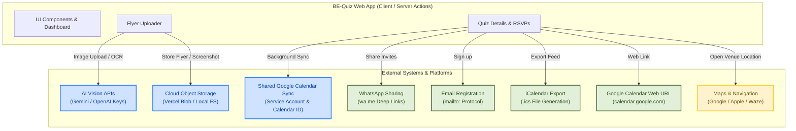

# External Integrations Overview

This document provides a comprehensive overview of all external systems, APIs, protocols, and third-party integrations supported or planned in the **BE-Quiz** application, distinguishing between zero-setup generic protocols, infrastructure-provisioned integrations, and pending roadmap items.

---

## Summary Matrix

| Integration / Feature Category  | Setup Requirement           | Status                | Supported Platforms / Protocols          | Description & Implementation Details                                                                                                                                            |
| :------------------------------ | :-------------------------- | :-------------------- | :--------------------------------------- | :------------------------------------------------------------------------------------------------------------------------------------------------------------------------------ |
| **WhatsApp Sharing**            | **Zero-Setup (Generic)**    | **Active**            | WhatsApp Click-to-Chat (`wa.me`)         | Pre-fills friendly greetings, join links, and event details for sharing invites or quiz notifications over WhatsApp.                                                            |
| **Email Registration**          | **Zero-Setup (Generic)**    | **Active**            | Standard `mailto:` protocol              | Pre-fills organizer email addresses and structured registration body text for mail-based quiz sign-ups.                                                                         |
| **iCalendar (`.ics`) Export**   | **Zero-Setup (Generic)**    | **Active**            | RFC 5545 iCalendar standard              | Generates `.ics` calendar subscription feeds and downloadable event files so players can add quizzes to Apple Calendar, Outlook, etc.                                           |
| **Google Calendar Web Links**   | **Zero-Setup (Generic)**    | **Active**            | Google Calendar Web URL API              | Generates direct web links (`calendar.google.com/calendar/render`) pre-populated with quiz title, start/end times, and location.                                                |
| **AI Vision / OCR**             | **Specific Setup Required** | **Active**            | Google Gemini Vision / OpenAI Vision     | Scans uploaded quiz flyer images or poster attachments to automatically extract structured event metadata (title, date, time, location, team size, entry fee, organizer email). |
| **Cloud Object Storage**        | **Specific Setup Required** | **Active**            | Vercel Blob (`@vercel/blob`)             | Stores uploaded quiz flyers and feedback diagnostic screenshots in cloud blob storage, with local filesystem fallback.                                                          |
| **Shared Google Calendar Sync** | **Specific Setup Required** | **Active**            | Google Calendar API v3 (Service Account) | Server-side background synchronization of team quizzes directly into an organization's central Google Calendar via service account credentials.                                 |
| **Maps & Navigation**           | **Specific Setup Required** | **Planned (Roadmap)** | Google Maps / Apple Maps / Waze          | Tapping venue addresses on quiz cards or detail views to open direct route navigation in external map apps.                                                                     |

---

## Integration Architecture Diagram

**Legend:**

- Green (Generic) = Zero-Setup Protocol Links (Always work when enabled)
- Blue (Specific) = Infrastructure & Credential Setup Required
- Yellow (Planned) = Planned / Roadmap Integration (NYI)

---

## Dynamic Capability Guardrails

BE-Quiz implements a strict capabilities pattern (`src/features/capabilities/`) evaluated at runtime from environment variables:

1. **Conditional UI Rendering:** Components check active capabilities (`useCapabilities()`) before rendering integration-dependent UI elements (e.g., the AI Flyer Upload tab in `QuizEntryForm` is hidden or disabled when `vision` is false).
2. **Graceful Fallbacks:** If an integration is unconfigured, the app falls back cleanly (e.g., manual entry) rather than presenting broken functionality.
3. **Storage & AI Synergy:** The Flyer Uploader relies on both AI Vision (to parse text) and Cloud Storage (to persist the uploaded poster). When either is disabled, the system steers users toward manual entry, preventing orphaned or useless flows.
