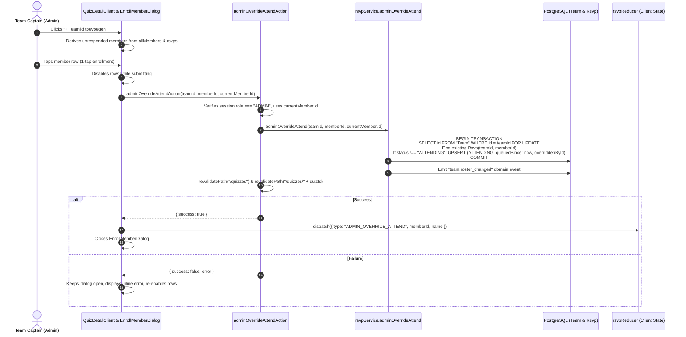

# Design Specification: Admin Member Lineup Enrollment

**Date:** 2026-11-21  
**Topic:** Team Operations — Admin Direct Member Lineup Enrollment (Roadmap Item #10 / Value Rank 3)  
**Status:** Implemented  
**Branch:** `feat/admin-quiz-edit-and-enrollment`

---

## 1. Intent & The Why

In pub quiz teams, team members frequently coordinate via WhatsApp, phone calls, or verbally in person rather than opening the app immediately (e.g. texting the captain: _"I'm in for Friday!"_).

While administrators could already:

1. Override attendance for players who had explicitly clicked _"Ik pas"_ (`DECLINED`), and
2. Add external guest players by name (`AddGuestDialog`),

they had **no direct in-app control to seat registered team members who had not yet responded** in the app. The captain was forced to either wait for the teammate to log in or create a temporary duplicate guest entry under their name.

The **Admin Member Lineup Enrollment** feature provides captains and admins with an immediate, 1-tap control on the quiz detail view to enroll any registered team member into the lineup.

---

## 2. Goals, Non-Goals & Anti-Goals

### 2.1 Goals

- **Direct Admin Enrollment:** An administrator can enroll any unresponded registered team member directly into the lineup from the quiz detail view (`/quizzes/[id]`).
- **Direct 1-Tap UX:** Clean dialog opened via `+ Teamlid toevoegen` (positioned in `QuizDetailClient.tsx` alongside `+ Gast toevoegen`), where tapping a member's name immediately enrolls them without extra clicks or dropdown menus.
- **Standard FIFO Capacity Rules:** Enrolled members occupy team slots identically to regular RSVPs. If capacity (`maxTeamSize`) is open, the player enters the active lineup; if full, they enter the reserve/waitlist queue in chronological order (`queuedSince = now()`). If the member is already `ATTENDING` in PostgreSQL (e.g. concurrent RSVP), their existing `queuedSince` is preserved.
- **Player Autonomy & Self-Correction:** The enrolled player retains full sovereignty over their account. When they open the app, they see their updated status and can change it to _"Ik pas"_ at any time if their availability changes.
- **Atomic Concurrency Protection:** All database writes are guarded by existing PostgreSQL row-level locks on `Team` (`SELECT id FROM "Team" WHERE id = ${teamId} FOR UPDATE`) and idempotent `ATTENDING` checks within the transaction.
- **Single Source of Truth:** Enrolled players are managed directly inside the unified `rsvpReducer.ts` collection without introducing parallel state arrays.

### 2.2 Non-Goals

- **Multi-Select Batch Enrollment:** Enrolling multiple teammates in a single bulk transaction is intentionally deferred to avoid overcomplicating the dialog on mobile. Enrollment is 1 member per submission.
- **Complex Clock Synchronization / Optimistic Revisions:** Avoiding complex timestamp reconciliation headers; idempotent already-attending protection with member self-correction is sufficient.
- **Guest Conversion:** Guests are distinct from members; this feature operates strictly on registered team members.
- **Re-enrolling Declined Players in the Dialog:** Players who already tapped _"Ik pas"_ (`DECLINED`) continue to appear as chips under `Afgemeld` with `+ Aanmelden` in `TeamLineup.tsx` and are excluded from `EnrollMemberDialog`.

### 2.3 Anti-Goals

- **Duplicate Service Methods:** Do not create a redundant `adminEnrollMember` service method when `adminOverrideAttend` already performs an atomic upsert with audit fields.
- **Split Lineup Collections:** Never store uncommitted or enrolled members in disconnected client state arrays.

---

## 3. Evaluated Approaches

### Approach 1: Dedicated Server Action & Separate Conditional Service

- **Concept:** Introduce `adminEnrollMemberAction` and `enrollMemberByAdmin` service method with conditional rejection if the player had recently declined.
- **Trade-offs:** Adds unnecessary duplicate code and locks out admins from overriding a player who declined earlier (e.g. 2 weeks ago) when the captain wants to put them in the team.
- **Status:** Rejected.

### Approach 2: Optimistic Concurrency with Client Timestamps

- **Concept:** Client sends screen load timestamp. If member updated status since that timestamp, reject request.
- **Trade-offs:** Introduces client/server clock skew issues and unnecessary HTTP synchronization complexity for a low-frequency team coordination action.
- **Status:** Rejected.

### Approach 3: Unified Admin Action with Player Autonomy (Selected)

- **Concept:** Reuse the existing `adminOverrideAttendAction` and `adminOverrideAttend` service method (ensuring the server action uses `currentMember.id` from the authenticated session and preserves `queuedSince` if already `ATTENDING`). Extend `rsvpReducer.ts` action `ADMIN_OVERRIDE_ATTEND` to handle both existing declined members and newly enrolled unresponded members.
- **Trade-offs:** Minimal code additions, leverages already-tested row-locked atomic transactions, and gives the captain full operational authority while preserving player self-correction.
- **Status:** **Selected.**

---

## 4. Architectural Design & Component Contracts

### 4.1 Data Flow & Service Layer



### 4.2 Client State: `src/lib/rsvpReducer.ts`

Extend `ADMIN_OVERRIDE_ATTEND` in `RsvpAction`:

```ts
export type RsvpAction =
  | { type: "USER_RSVP"; memberId: string; name: string; status: "ATTENDING" | "DECLINED" }
  | { type: "ADD_GUEST"; id: string; guestName: string; invitedById: string; invitedByName: string }
  | { type: "REMOVE_GUEST"; id: string }
  | { type: "ADMIN_OVERRIDE_DECLINE"; memberId: string }
  | { type: "ADMIN_OVERRIDE_ATTEND"; memberId: string; name?: string }
  | { type: "ADMIN_REORDER"; sourceIndex: number; destinationIndex: number };
```

Reducer logic for `ADMIN_OVERRIDE_ATTEND`:

```ts
case "ADMIN_OVERRIDE_ATTEND": {
  const existing = state.find((r) => r.memberId === action.memberId);
  if (existing) {
    if (existing.status === "ATTENDING") {
      return state;
    }
    return state.map((r) =>
      r.memberId === action.memberId
        ? { ...r, status: "ATTENDING", queuedSince: new Date() }
        : r
    );
  }
  return [
    ...state,
    {
      id: action.memberId,
      memberId: action.memberId,
      name: action.name || "Teamlid",
      isGuest: false,
      status: "ATTENDING",
      queuedSince: new Date(),
    },
  ];
}
```

### 4.3 UI Component: `src/components/EnrollMemberDialog.tsx`

A clean, compact dialog following `AddGuestDialog.tsx` styling (`fixed inset-0 z-50 ... backdrop-blur-xs`) and implementing **Direct 1-Tap Selection**:

- **Trigger:** Button `+ Teamlid toevoegen` rendered in `QuizDetailClient.tsx` when `isAdmin === true`, positioned right beside the existing `+ Gast toevoegen` button in the action bar above `<TeamLineup />`.
- **Props:**
  ```ts
  export interface EnrollMemberDialogProps {
    isOpen: boolean;
    onClose: () => void;
    availableMembers: Array<{ id: string; name: string }>;
    onEnroll: (memberId: string, memberName: string) => Promise<void> | void;
    isSubmitting?: boolean;
  }
  ```
- **Behavior (Direct 1-Tap with Inline Error Handling):**
  - Displays eligible unresponded teammates as full-width clickable `button` rows inside a scrollable container (`max-h-72 overflow-y-auto`) so landscape mobile viewports and larger rosters remain usable.
  - Tapping a member row disables all rows while `onEnroll(member.id, member.name)` is awaited (preventing double taps).
  - On success, resets any local error and calls `onClose()`.
  - On error (thrown from `onEnroll` when `!res.success`), keeps the dialog open, renders the error message inline (matching `AddGuestDialog.tsx`), and re-enables the rows.
  - If `availableMembers` is empty (every team member has already responded `ATTENDING` or `DECLINED`): displays a muted message _"Alle teamleden hebben al gereageerd."_ with a close button.

### 4.4 Server & Component Wiring

- **`src/services/memberService.ts`:**
  - Add `getAllMembers(): Promise<Array<{ id: string; name: string }>>` selecting `{ id: true, name: true }` ordered by `name: "asc"`.
- **`src/app/quizzes/[id]/page.tsx`:**
  - When `currentMember.role === "ADMIN"`, fetch `allMembers = await getAllMembers()`; for non-admins, pass `[]` to avoid unnecessary queries.
  - Pass `allMembers` to `<QuizDetailClient />`.
- **`src/components/QuizDetailClient.tsx`:**
  - Add optional prop `allMembers?: Array<{ id: string; name: string }>` (defaulting to `[]` so existing component test suites remain backwards-compatible).
  - Purely derive unresponded members from the authoritative `rsvps` reducer state (excluding the active admin who has `RsvpControl` above):
    ```ts
    const respondedMemberIds = new Set(rsvps.filter((r) => r.memberId).map((r) => r.memberId!));
    const enrollableMembers = allMembers.filter(
      (m) => m.id !== currentMemberId && !respondedMemberIds.has(m.id)
    );
    ```
  - Add `handleEnrollMember(memberId: string, memberName: string)` (matching `handleAddGuest`): sets `isEnrollingMember` state, awaits `adminOverrideAttendAction(team.id, memberId, currentMemberId)`, throws `new Error(res.error || "Fout bij aanmelden van teamlid")` if `!res.success`, and on success dispatches `{ type: "ADMIN_OVERRIDE_ATTEND", memberId, name: memberName }`.
  - Also update `handleAdminOverrideAttend` (used by `TeamLineup`'s `+ Aanmelden` chip) to check `res.success` and surface `setErrorMessage` via `AlertDialog` if the server action fails.
- **`src/actions/adminActions.ts` & `src/services/rsvpService.ts`:**
  - `adminOverrideAttendAction(teamId, memberId, _adminId?)` keeps its signature for caller compatibility, verifies `currentMember?.role === "ADMIN"`, passes **`currentMember.id`** (never trusting a client-supplied `adminId`) to `adminOverrideAttend`, and revalidates both `"/quizzes"` and `"/quizzes/${quizId}"`.
  - `rsvpService.adminOverrideAttend(teamId, memberId, adminId)` returns `Promise<{ quizId: string }>` (or `quizId`) and, inside the `SELECT ... FOR UPDATE` transaction, checks `tx.rsvp.findUnique({ where: { teamId_memberId: { teamId, memberId } } })`: if `existing?.status === "ATTENDING"`, it leaves `queuedSince` untouched and avoids bumping an already-attending member to the back of the queue.

---

## 5. Security & Invariants

1. **Strict Admin Verification & Session Audit Integrity:** Only users whose server session contains `role: "ADMIN"` may execute `adminOverrideAttendAction`, and `overriddenById` is always sourced from `currentMember.id` on the server session.
2. **Referential Integrity:** `Member` records are app-wide and `Team` records are per-quiz; PostgreSQL foreign-key constraints on `teamId` and `memberId` guarantee only valid existing teams and registered members can be linked.
3. **Database Concurrency & Idempotent Queue Position:** Row-level lock (`SELECT FOR UPDATE` on `"Team"`) serializes concurrent roster mutations and preserves `queuedSince` if a player became `ATTENDING` just before the admin enrolled them.
4. **Domain Event Propagation:** When an admin enrolls a member (status transitions to `ATTENDING`), `team.roster_changed` is emitted, triggering background calendar updates (e.g. shared Google Calendar sync) seamlessly via Next.js `after()`.

---

## 6. Testing Strategy (Vitest `environment: "node"`)

All tests run under Vitest `environment: "node"` without `jsdom` or `@testing-library/react`, using `renderToStaticMarkup` for component markup verification (per Architecture Invariant 7):

1. **Reducer & Derivation Unit Tests (`tests/lib/rsvpReducer.test.ts`):**
   - Test `ADMIN_OVERRIDE_ATTEND` when member already exists with `status: "DECLINED"` (switches to `ATTENDING` with updated `queuedSince`).
   - Test `ADMIN_OVERRIDE_ATTEND` when member does not exist in `rsvps` yet (appends new `ATTENDING` entry with `name` and `queuedSince`).
   - Test `ADMIN_OVERRIDE_ATTEND` when member is already `ATTENDING` (returns state unchanged, preserving `queuedSince`).
2. **Component Markup Tests (`tests/components/EnrollMemberDialog.test.tsx`):**
   - Verify `renderToStaticMarkup` outputs `""` when `isOpen={false}`.
   - Verify rendering of eligible member names as button rows when `isOpen={true}`.
   - Verify empty state message (_"Alle teamleden hebben al gereageerd."_) when `availableMembers` is `[]`.
   - Verify rows render with `disabled` attribute when `isSubmitting={true}`.
3. **Server Action & Service Tests (`tests/services/rsvpAdminOverride.test.ts` & `tests/admin/adminAttendAction.test.ts`):**
   - Verify enrolling a never-responded member creates an `ATTENDING` `Rsvp` with `queuedSince` and `overriddenById` and places them in `active` or `reserves` per `maxTeamSize`.
   - Verify calling `adminOverrideAttend` on a member who is already `ATTENDING` preserves their existing `queuedSince` timestamp.
   - Verify `adminOverrideAttendAction` passes `currentMember.id` (from session) to `adminOverrideAttend` and revalidates both `/quizzes` and `/quizzes/[quizId]`.

---

## 7. Documentation Sync (On Implementation)

- Update `docs/roadmap.md` Item #10 (`Scope:`) to reflect reusing `adminOverrideAttendAction` rather than introducing `adminEnrollMemberAction`.
- Update `docs/architecture/rsvp-state.md` to document `ADMIN_OVERRIDE_ATTEND`'s optional `name` payload for enrolling unresponded members.
